# Balu's Training

*Offline-first PWA for a handball team: attendance, training plans, video clips,
and fair team-balancing via an individual ELO rating. FastAPI + SQLite backend,
vanilla-JS service-worker frontend with an offline outbox, deployed as a systemd
user service. No external APIs.*

---

Früher `Spieler-ELO`. Heute die zentrale App des Frauenteams: Zu- und Absagen,
Trainingsplanung, Taktik-Wiki, Spielanalyse mit Video und – wie am Anfang – faire
Teams per ELO für die Trainingsspiele. Spielerinnen sehen **keine ELO und keine
Rangliste**; das ist Absicht.

> Läuft auf dem eigenen Homeserver, ohne laufende Kosten. Externe Dienste nur dort,
> wo sie nötig sind: Verbandsdaten (Liga), SpielerPlus (Übergangsbrücke) und für den
> Coach-Chat ein Sprach-/Sprachmodell-Anbieter (siehe `trainer.py`).

## Screenshots

Aufgenommen mit erfundenen Demo-Daten.

| Startseite | Zu- und Absagen | Trainingsplan |
|---|---|---|
| 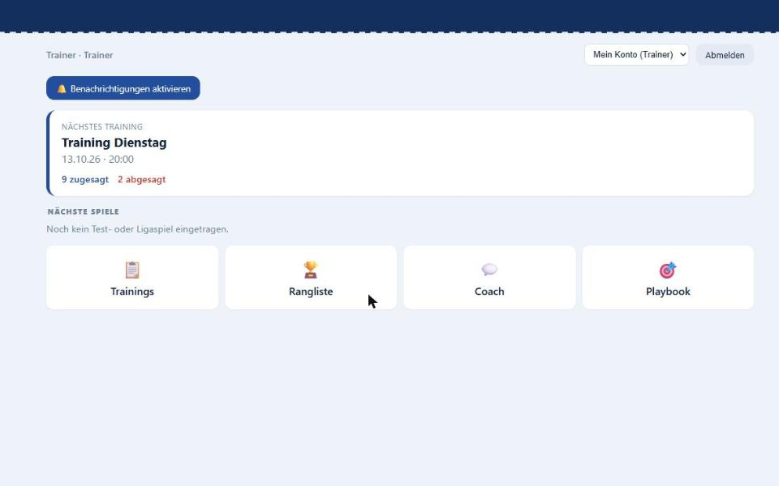 | 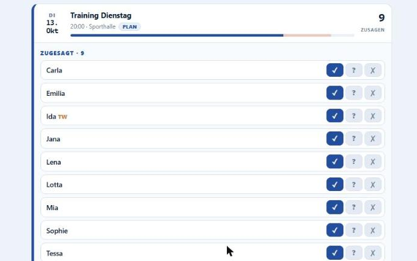 | 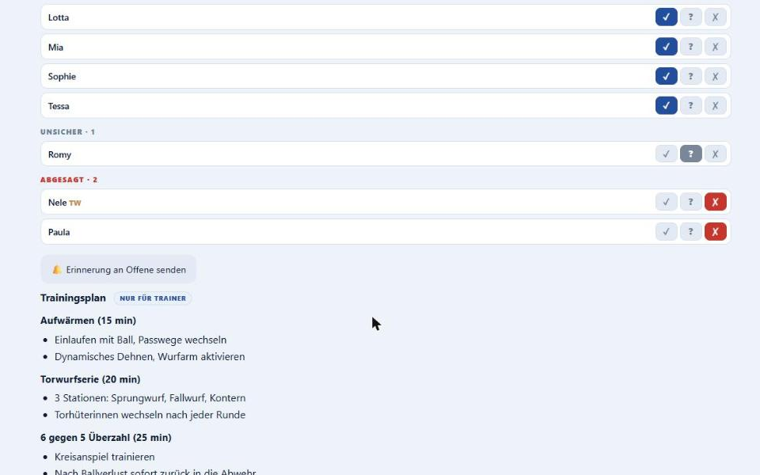 |

Die aktuelle Version steht im Kopf der App und in
**[CHANGELOG.md](CHANGELOG.md)** — dort gehört zu **jeder** neuen Version ein
Eintrag, was geändert wurde (samt Checkliste für den Versions-Bump).

## Was die App kann

Die Rolle bestimmt, was man sieht: **Trainer** bekommen alles, **Spielerinnen** ihre
eigenen Sachen. Die Rechte werden im Server erzwungen (`app.py`), nicht nur im
Frontend ausgeblendet. Unten die sechs Bereiche der App. Jeden Bereich zeigt die
**[Anleitung in Bildern](#anleitung-in-bildern)** weiter unten (auch als
[PDF](docs/anleitung-funktionen/Anleitung-Funktionen.pdf));
die Installation auf Android und iPhone steht in der
[Anleitung zum Videoschauen](docs/anleitung-videos/Anleitung-Videos.pdf).

**Home** – Übersicht mit dem nächsten Training (Zu-/Absage direkt dort), den nächsten drei
Spielen und Abkürzungen; dazu **Liga** mit Tabelle und Spielplan der Bezirksoberliga
(Daten vom Verband, zwischengespeichert, mit Hinweis wenn die Quelle nicht erreichbar ist).

**Ich** – *Mein Profil* mit Portrait, Trainingsbeteiligung, Laufchallenge und eigener
Spielstatistik; *Videos* mit der Videoanalyse der Spiele und einzelnen Szenen-Clips
(jede Spielerin sieht nur ihre eigenen Szenen, das ganze Spiel sehen alle).

**Training**
- *Termine:* Trainings, Testspiele und Ligaspiele in einer Übersicht, farblich getrennt.
  Zu-/Absage in der App (bei Absage mit Grund), Trainer tragen für andere ein, Frühwarnung
  bei weniger als sechs Zusagen, Push-Erinnerung an alle ohne Antwort.
- Im Termin (Trainer): **Trainingsplan als Blöcke** (Dauer optional, Übungen aus der
  Sammlung übernehmbar, nur für Trainer sichtbar) und der Knopf „Aus SpielerPlus aktualisieren“.
- *Aufstellung:* alle Zusagen auf ihrer Position im Spielfeld (Training oder Spiel,
  Portraits oder Namen).
- *Einteilung* (Trainer): Zusagen eines Termins übernehmen (oder Anwesende anhaken), faire
  Teams für 2 bis 4 Mannschaften bilden, Ergebnis eintragen (ELO).
- *Übungen* (Trainer): Übungssammlung. *Coach* (Trainer): aus Text oder Sprachnachricht
  einen Planvorschlag erzeugen.
- **Automatische Termine:** Montag und Donnerstag legt der Server die Trainings der
  nächsten 14 Tage selbst an (`trainings_termine.py`).

**Team** (nur Trainer) – *Rangliste* mit ELO-Verlauf je Spielerin, *Kader* (Stärkestufe,
Positionen, aktiv/inaktiv), *Statistik* (Notizseiten), *Videos* (Szenen-Clips) und *Nutzung*
(wer nutzt die App, Geräte, Fehlerberichte).

**Taktik** – *Playbook* als Seitenbaum (Spielzüge, Überzahl, Unterzahl, Abwehr; alle lesen,
Trainer bearbeiten, auch offline) und *Gegner* (Gegnercheck, nur Trainer).

**Saison** (nur Trainer) – *Orga*, *Statistik Spiele* (Auswertung je analysiertem Spiel:
Effektivität, Spielzüge mit Ampel, je Spielerin und Position) und *Notizen*. Trainer können
die App außerdem **als eine Spielerin ansehen** („Ansehen als“ auf Home).

**Querschnitt**
- **Offline-first:** Service Worker, lokale Kopie und Outbox. Eingaben ohne Netz werden
  nachgesendet, Wiederholungen sind idempotent.
- Installierbar als PWA, auch als Android-App (TWA); Querformat fürs Tablet in der Halle.
- Anmeldung per Name und PIN, gemeinsam genutzte Geräte werden beim Kontowechsel geleert.
- Sichtbare Versionsnummer und gepflegter [Changelog](CHANGELOG.md).

## Anleitung in Bildern

<!-- ANLEITUNG-START -->

Alle Bilder zeigen eine Testinstanz mit erfundenen Namen. Dieselbe Anleitung gibt es als [PDF](docs/anleitung-funktionen/Anleitung-Funktionen.pdf). Sie wird mit `py docs/anleitung-funktionen/pdf_bauen.py` neu gebaut, dabei wird auch dieser Abschnitt erzeugt.

### Anmelden und zurechtfinden

*Für: Alle*

Du meldest dich mit deinem Namen und der PIN an, die du vom Trainerteam bekommen hast. Danach bleibst du angemeldet. Unten wechselst du zwischen den Bereichen, oben unter dem Wappen zwischen den Seiten des Bereichs.

| 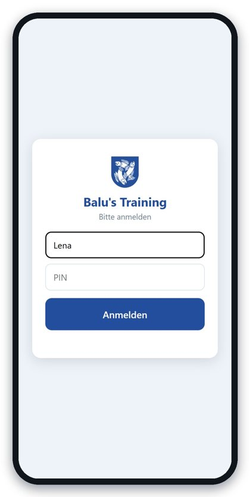 | 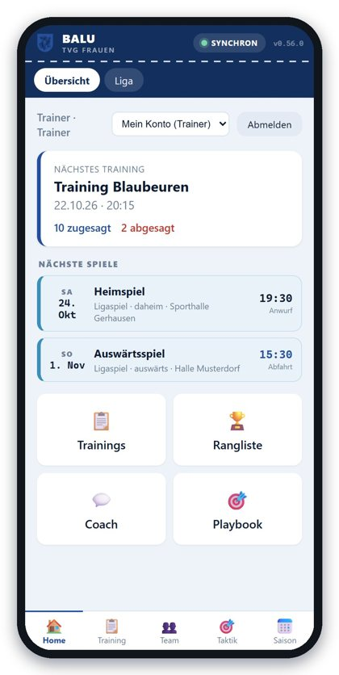 | 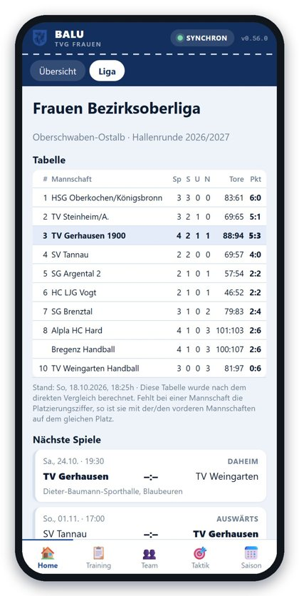 |
|:---:|:---:|:---:|
| **1. Anmelden**<br>Name und PIN eingeben. Dein Zugang gehört zu deinem Spielerprofil, du siehst nur, was für dich bestimmt ist. | **2. Home**<br>Das nächste Training und die nächsten Spiele. Der Punkt oben rechts zeigt, ob die App mit dem Server verbunden ist. Ohne Netz bleibt sie benutzbar. | **3. Liga**<br>Tabelle und Spielplan der Bezirksoberliga. Die Daten kommen vom Verband, unser Team ist hervorgehoben. |

### Termine

*Für: Alle, Anlegen nur Trainer*

Unter **Training → Termine** stehen alle kommenden Trainings, Testspiele und Ligaspiele. Trainings sind weiß, Spiele farbig. Der Balken zeigt die Zusagen. Die Trainings am Montag und Donnerstag legt die App selbst an, du musst nichts eintragen.

| 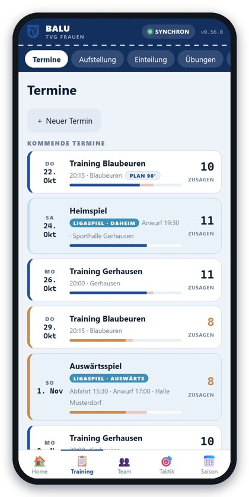 | 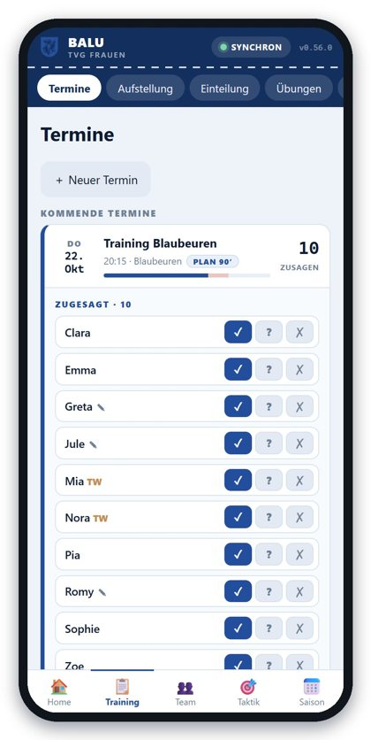 | 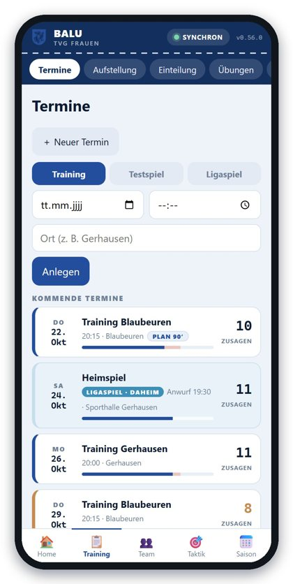 |
|:---:|:---:|:---:|
| **1. Terminliste**<br>Rechts steht die Zahl der Zusagen. Die Warnung oben erscheint, wenn bei einem Termin weniger als sechs zugesagt haben. | **2. Aufklappen**<br>Ein Tipp auf den Termin zeigt, wer zu- und abgesagt hat. Trainer tragen hier für andere ein: Haken = zusagen, Fragezeichen = unsicher, Kreuz = absagen. | **3. Neuer Termin**<br>Trainer legen Trainings, Testspiele und Ligaspiele von Hand an. Bei Spielen kommen Gegner, Heim oder Auswärts und die Abfahrt dazu. |

### Training vorbereiten

*Für: Trainer*

Mit **Öffnen & Plan** in einem Termin kommst du in die Detailansicht. Dort siehst du auf einen Blick, wer kommt, schickst Erinnerungen und schreibst den Trainingsplan.

| 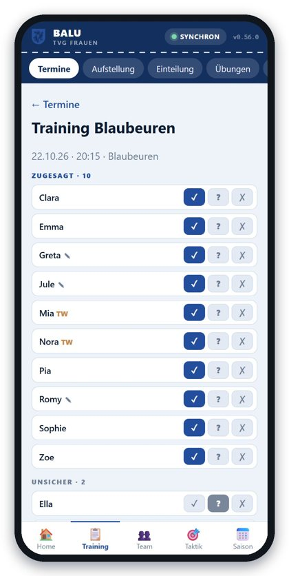 | 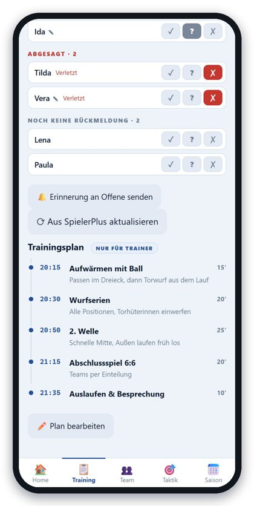 | 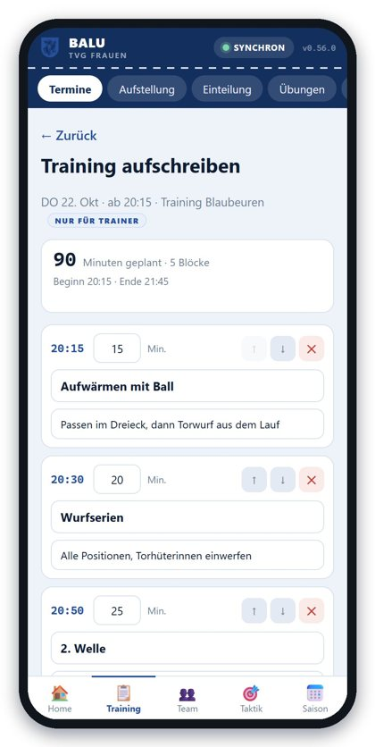 |
|:---:|:---:|:---:|
| **1. Wer kommt?**<br>Alle Spielerinnen nach Antwort sortiert. Ein kleiner Stift zeigt, dass du die Antwort selbst eingetragen hast. | **2. Erinnern und aktualisieren**<br>„Erinnerung an Offene senden“ schickt eine Mitteilung an alle ohne Antwort. „Aus SpielerPlus aktualisieren“ holt den neuesten Stand sofort. | **3. Plan schreiben**<br>Der Plan besteht aus Blöcken mit Titel, Notiz und Dauer. Mit den Pfeilen sortierst du sie um. Spielerinnen sehen den Plan nicht. |

### Zu- und Absagen

*Für: Spielerinnen*

Zu- und Absage gehören zu den wichtigsten Dingen in der App. Antworten kannst du auf der Startseite oder im Termin. Die Antwort sehen alle, damit der Trainer planen kann.

| 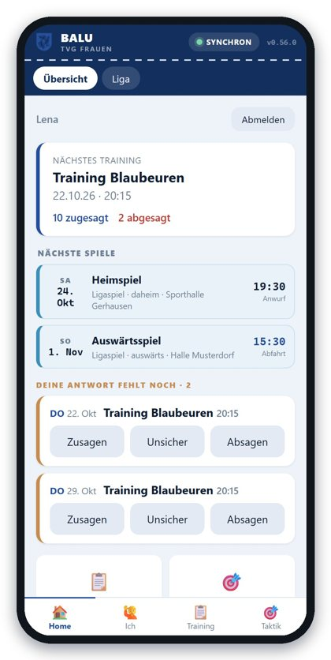 | 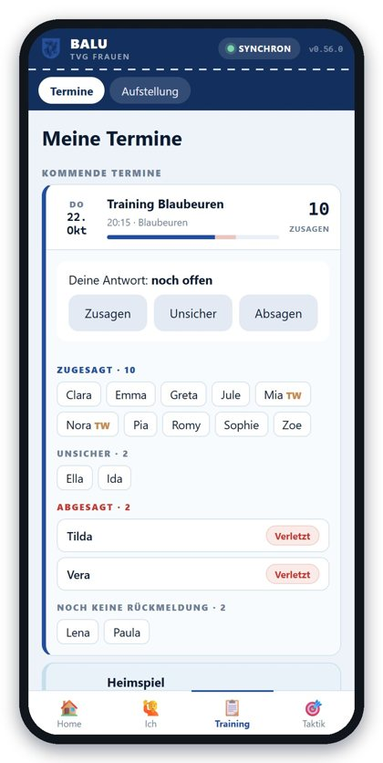 | 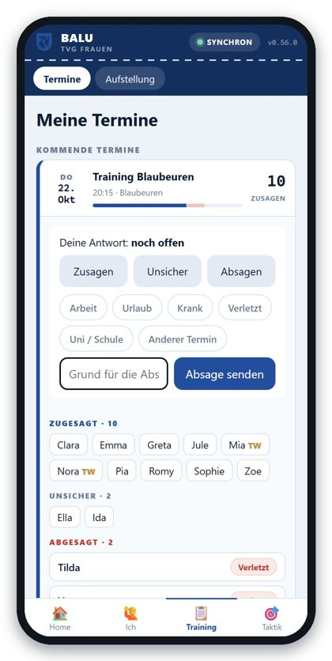 |
|:---:|:---:|:---:|
| **1. Auf der Startseite**<br>Wo deine Antwort noch fehlt, steht sie unter „Deine Antwort fehlt noch“ mit drei Knöpfen. | **2. Im Termin**<br>Oben deine Antwort, darunter alle anderen nach Zusage, Unsicher, Absage und noch keine Rückmeldung. | **3. Absagen mit Grund**<br>Bei einer Absage wählst du einen Grund oder schreibst einen eigenen. Ohne Grund geht die Absage nicht raus. |

### Aufstellung und Teams

*Für: Trainer*

Aus den Zusagen entsteht die Aufstellung auf dem Spielfeld. Für Trainingsspiele teilt die App die Anwesenden in möglichst gleich starke Teams.

| 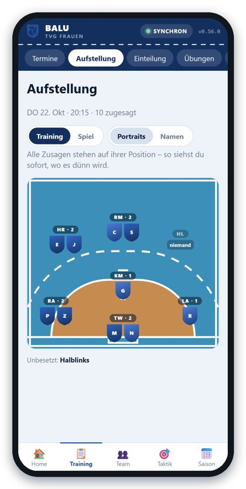 | 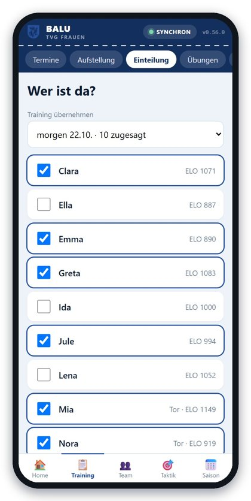 | 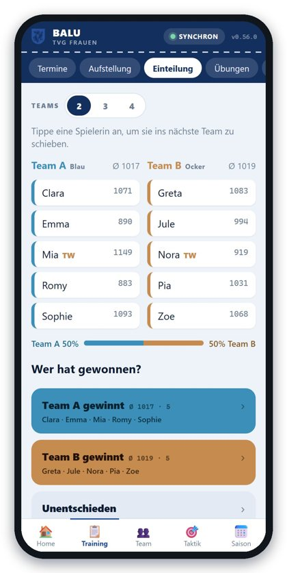 |
|:---:|:---:|:---:|
| **1. Aufstellung**<br>Alle Zusagen stehen auf ihrer Position. So siehst du sofort, wo es dünn wird. Oben wechselst du zwischen Training und Spiel und zwischen Portraits und Namen. | **2. Wer ist da?**<br>Wähle oben einen Termin, dann sind die Spielerinnen mit Zusage schon angehakt. Du kannst von Hand ändern. Die ELO-Werte siehst nur du als Trainer. | **3. Teams bilden**<br>Mit 2, 3 oder 4 Teams. Die Spielstärke wird gleich verteilt, Torhüterinnen werden aufgeteilt. Antippen schiebt eine Spielerin ins nächste Team. |

### Ergebnis, Übungen und Coach

*Für: Trainer*

Nach dem Spiel trägst du das Ergebnis ein. Beim Planen helfen dir die Übungssammlung und der Coach, der aus deiner Beschreibung einen Plan vorschlägt.

| 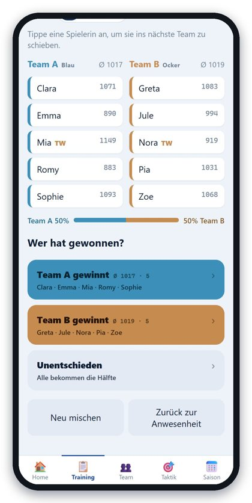 | 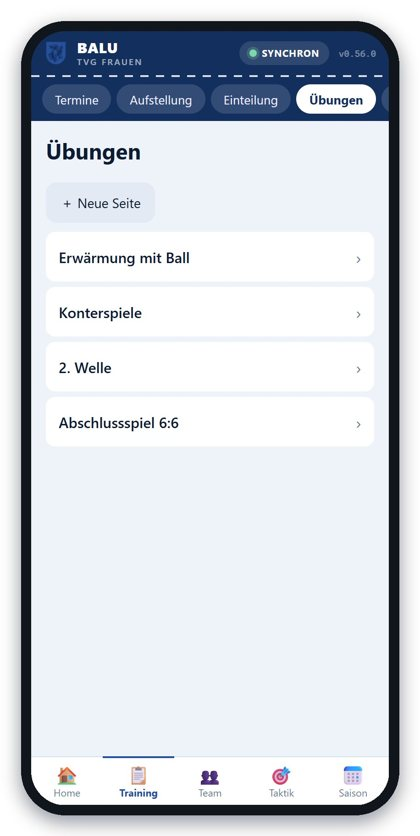 | 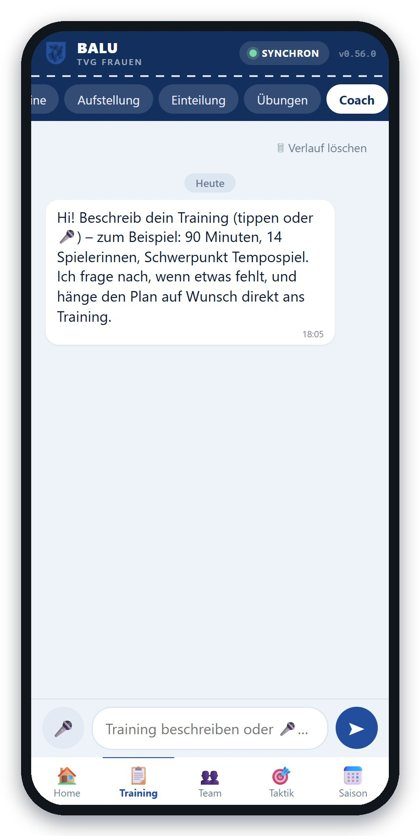 |
|:---:|:---:|:---:|
| **1. Ergebnis eintragen**<br>Tippe auf das Team, das gewonnen hat, oder auf Unentschieden. Die ELO-Werte ändern sich, ein Spiel lässt sich rückgängig machen. | **2. Übungen**<br>Die Sammlung eurer Übungen. Beim Planen übernimmst du sie als Block. | **3. Coach**<br>Beschreibe das Training, getippt oder per Sprachnachricht. Der Coach fragt nach, wenn etwas fehlt, und hängt den Plan auf Wunsch direkt ans Training. |

### Mein Profil und Videos

*Für: Spielerinnen*

Unter **Ich** findest du alles zu dir selbst. Du siehst nur deine eigenen Zahlen und deine eigenen Szenen.

| 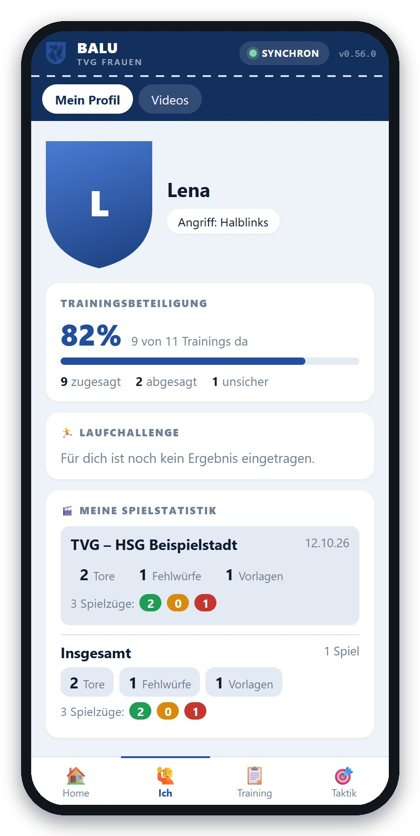 | 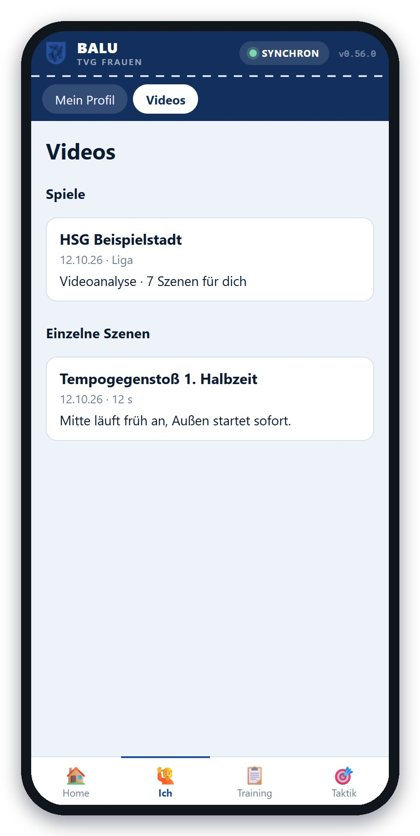 | 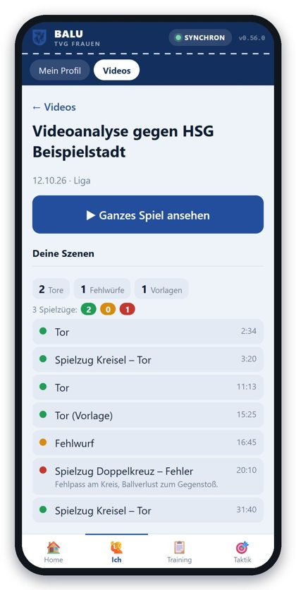 |
|:---:|:---:|:---:|
| **1. Mein Profil**<br>Deine Trainingsbeteiligung, die Laufchallenge und deine Statistik aus den analysierten Spielen. | **2. Videos**<br>Oben die Spiele mit Videoanalyse, darunter einzelne Szenen als kurze Clips. | **3. Videoanalyse**<br>Deine Tore, Fehlwürfe und Vorlagen im Spiel. Spielzüge sind mit einer Ampel bewertet. Ein Tipp auf eine Szene spielt den Clip ab. |

### Team: Rangliste und Kader

*Für: Trainer*

Der Bereich **Team** ist nur für das Trainerteam. Spielerinnen sehen weder ELO-Werte noch die Rangliste.

| 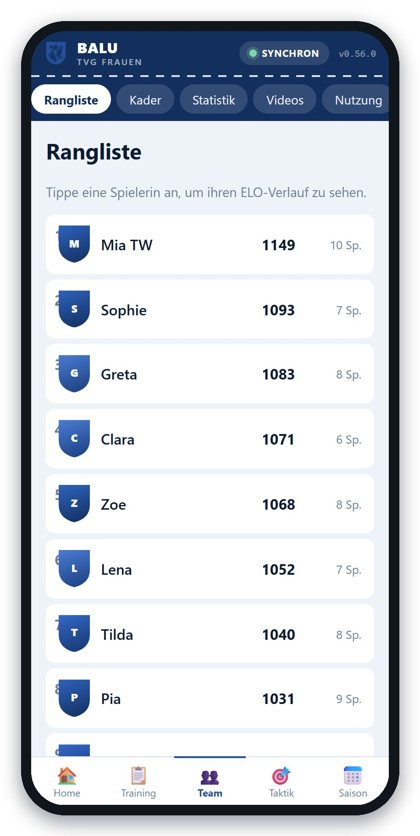 | 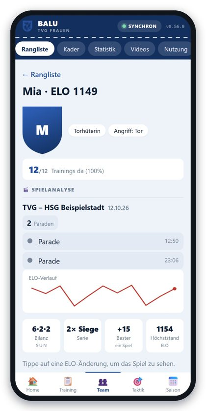 | 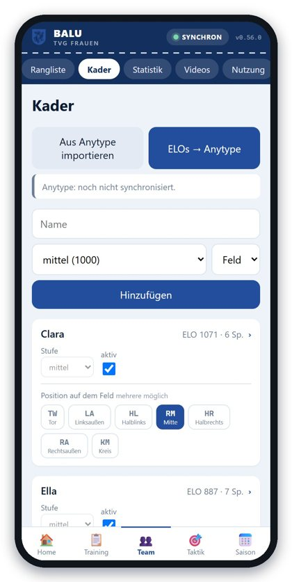 |
|:---:|:---:|:---:|
| **1. Rangliste**<br>Alle Spielerinnen nach ELO. Ein Tipp öffnet den Verlauf. | **2. Verlauf einer Spielerin**<br>Bilanz, Siegesserie, Höchststand, Trainingsbeteiligung und alle Spiele mit ihrer ELO-Änderung. | **3. Kader**<br>Spielerinnen anlegen, Stärkestufe und Positionen pflegen oder jemanden auf inaktiv setzen. Mehrere Positionen sind möglich. |

### Team: Statistik, Videos und Nutzung

*Für: Trainer*

Weitere Seiten im Bereich Team: eigene Statistik-Notizen, Szenen-Clips und die Übersicht, wer die App nutzt.

| 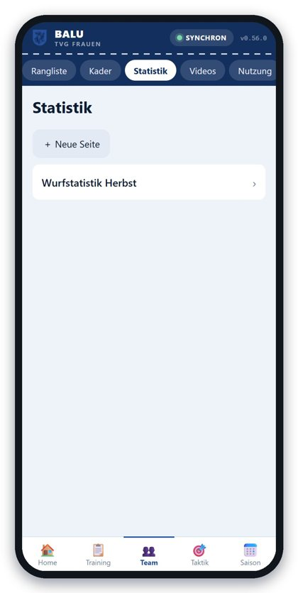 | 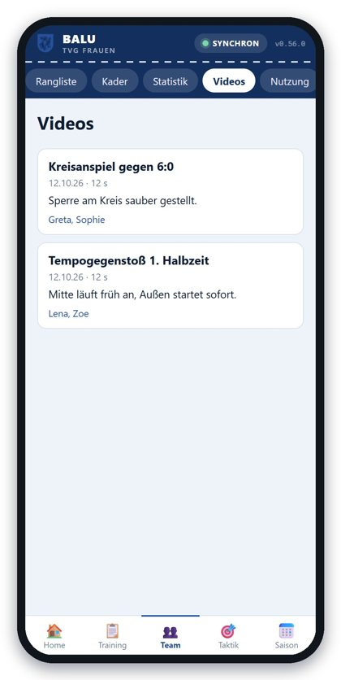 | 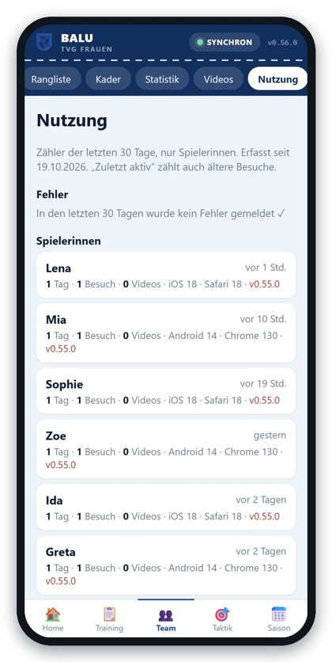 |
|:---:|:---:|:---:|
| **1. Statistik**<br>Freie Seiten für Auswertungen, die ihr festhalten wollt. | **2. Videos**<br>Einzelne Szenen als kurze Clips, jeweils einer oder mehreren Spielerinnen zugeordnet. Sie werden am PC geschnitten und hochgeladen. | **3. Nutzung**<br>Wer war wann in der App, mit welchem Gerät und welcher Version. Fehler werden gesammelt. IP-Adresse und Standort werden nicht gespeichert. |

### Taktik: Playbook

*Für: Alle, Bearbeiten nur Trainer*

Das Playbook ist euer Wissen zu Spielzügen, Überzahl, Unterzahl und Abwehr. Die Seiten sind als Baum geordnet, alle Spielerinnen können sie lesen.

| 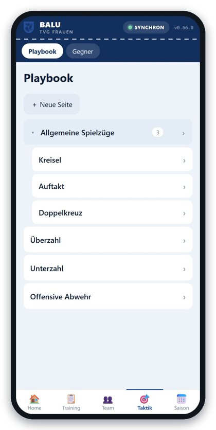 | 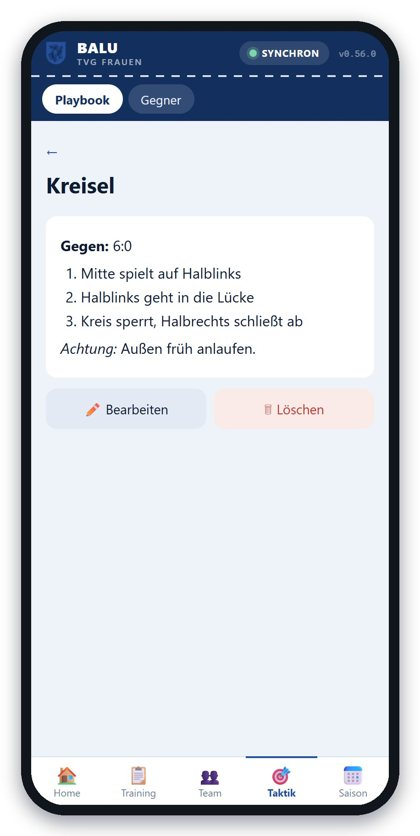 | 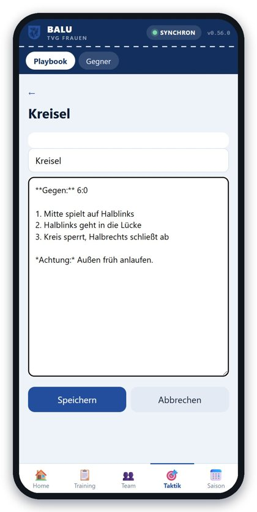 |
|:---:|:---:|:---:|
| **1. Playbook**<br>Eine Gruppe wie „Allgemeine Spielzüge“ klappt auf. Die Zahl zeigt, wie viele Unterseiten dazugehören. | **2. Seite lesen**<br>Zum Spielzug steht, gegen welche Abwehr er gedacht ist, und die Schritte nacheinander. | **3. Bearbeiten**<br>Trainer ändern den Text direkt in der App. Das geht auch ohne Netz, die Änderung wird danach nachgesendet. |

### Gegnercheck, Orga und Notizen

*Für: Trainer*

Drei weitere Sammlungen für das Trainerteam. Die Seiten funktionieren wie im Playbook: anlegen, bearbeiten, löschen.

| 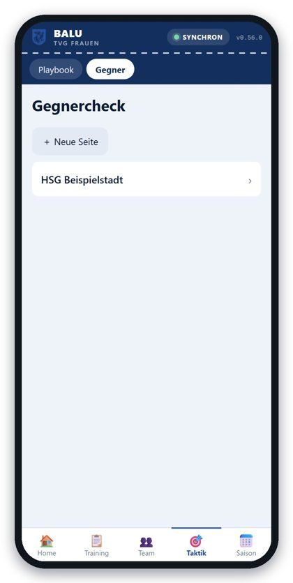 | 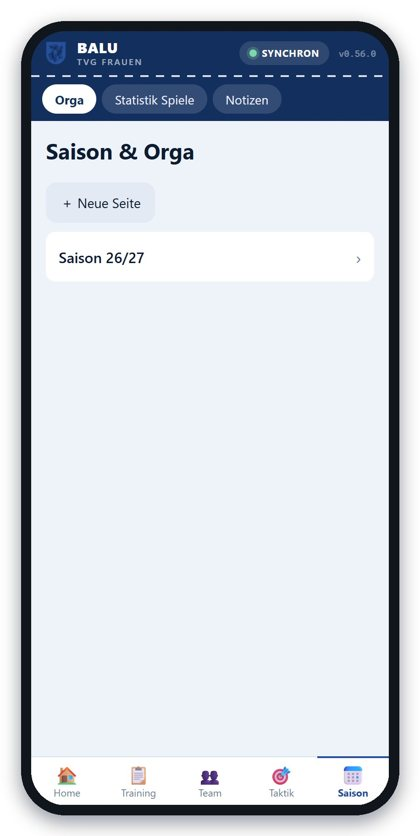 | 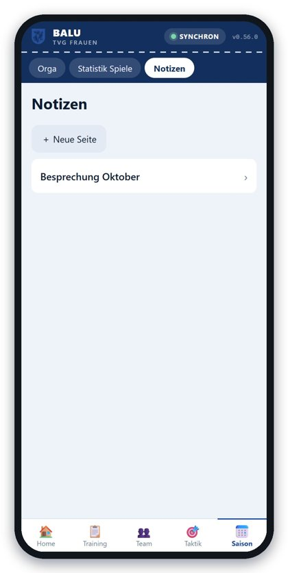 |
|:---:|:---:|:---:|
| **1. Gegnercheck**<br>Eine Seite je Gegner: wie sie verteidigen und worauf ihr achten sollt. Unter Taktik → Gegner. | **2. Saison und Orga**<br>Hallenzeiten, Termine und alles, was die Saison betrifft. Unter Saison → Orga. | **3. Notizen**<br>Besprechungen und Notizen des Trainerteams. Unter Saison → Notizen. |

### Spielstatistik und Ansehen als

*Für: Trainer*

Für jedes analysierte Spiel gibt es eine Auswertung. Und du kannst die App so ansehen, wie sie eine bestimmte Spielerin sieht.

| 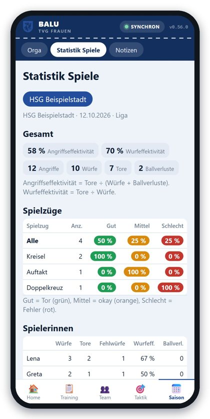 | 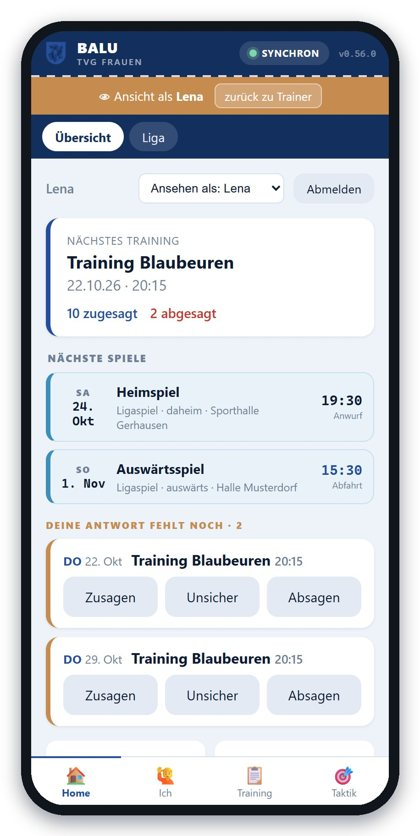 |
|:---:|:---:|
| **1. Statistik Spiele**<br>Angriffs- und Wurfeffektivität, die Spielzüge mit Anteil gut, mittel und schlecht, dazu jede Spielerin einzeln und nach Position. | **2. Ansehen als**<br>Oben auf Home wählst du „Ansehen als: Name“. Ein Balken erinnert dich daran. Mit „zurück zu Trainer“ bist du wieder du. |

### Wie die Zu- und Absagen zusammenkommen

*Für: Trainer*

**Wer kann antworten?** Jede Spielerin kann in der App selbst zu- oder absagen. Als Trainer kannst du außerdem für andere eintragen, zum Beispiel wenn jemand am Telefon oder per Nachricht absagt. Diese Einträge sind mit einem kleinen Stift markiert.

**Was holt die App aus SpielerPlus?** Solange das Team SpielerPlus noch nutzt, holt der Server die Zu- und Absagen von dort. Das passiert jeden Morgen und an Trainingstagen um 12:00, 16:00 und 18:30 Uhr. Mit „Aus SpielerPlus aktualisieren“ im Termin geht es auch sofort.

**Was gilt, wenn sich Angaben widersprechen?** Die App gewinnt. Was eine Spielerin selbst in der App antwortet oder was du als Trainer einträgst, überschreibt SpielerPlus nie. SpielerPlus füllt nur Lücken und aktualisiert Antworten, die selbst von dort stammen. Die Daten gehen nur in eine Richtung: von SpielerPlus in die App.

**Wann entstehen die Trainings?** Jeden Morgen legt die App die Trainings der nächsten 14 Tage selbst an: Montag 20:00 Uhr in Gerhausen und Donnerstag 20:15 Uhr in Blaubeuren. Änderungen an Titel, Uhrzeit oder Ort, die du von Hand machst, bleiben stehen.

**Und wenn etwas nicht stimmt?** Fehlt eine Spielerin in der Liste oder stimmt eine Antwort nicht, trag sie im Termin selbst ein. Die Version der App steht oben rechts neben dem Verbindungspunkt. Was sich in welcher Version geändert hat, steht im Changelog.

<!-- ANLEITUNG-ENDE -->

## SpielerPlus-Brücke

Ziel ist, dass die App **alles selbst** kann und SpielerPlus überflüssig wird. Bis
dahin holt `sp_import.py` die Zu-/Absagen der kommenden Trainings dorthin, damit
niemand doppelt pflegen muss.

- **Einbahnstraße:** SpielerPlus → App. Es wird nichts zurückgeschrieben.
- **Die App ist die Wahrheit:** Antworten aus der App oder vom Trainer
  (`quelle = app/trainer`) überschreibt der Import nie. Er ändert nur Antworten, die
  selbst aus SpielerPlus stammen. Das ist ein bedingter Upsert in `db.teilnahme_spiegeln`.
- **Kein Datenverlust:** Liefert SpielerPlus für einen Termin keine Namen, wird er
  übersprungen. Es wird nie ein Training gelöscht.
- **Austauschbar:** Nur `sp_import.py` kennt SpielerPlus. Zum Abschalten reichen diese
  Datei, der Cronjob und der Knopf „Aus SpielerPlus aktualisieren“.
- **Zuordnung** über `spieler.spielerplus_id`. Spielerinnen ohne Eintrag meldet der
  Lauf im Log.

Zeitplan am Server (Berlin-Zeit): 06:00 Trainings der nächsten 14 Tage anlegen,
06:10 Abgleich, an Trainingstagen zusätzlich 12:00, 16:00 und 18:30. Der Job
schreibt seinen Status für Home Assistant. Zugangsdaten stehen in der `.env`
des Sync-Ordners (`SP_SYNC_DIR`, Standard `~/anytype-sync`).

## Aufbau

| Datei / Ordner    | Zweck                                                       |
|-------------------|-------------------------------------------------------------|
| `elo.py`          | ELO-Berechnung (individuell gegen Gegnerteam-Schnitt)       |
| `teams.py`        | Faire Team-Aufteilung (min. ELO-Differenz, Torhüter-Pflicht)|
| `db.py`           | SQLite-Datenhaltung (Spieler, Spiele, ELO-Verlauf)          |
| `app.py`          | FastAPI-Backend (JSON-Endpunkte + liefert die PWA aus)      |
| `static/`         | PWA (index.html, app.js, style.css, manifest, sw, Icons)    |
| `portraits/`      | Original-Fotos der Spielerinnen (groß, unverändert)         |
| `static/portraits/` | Zugeschnittene Portraits für die App + `index.json`        |
| `portraits.py`    | Baut aus den Originalen die Bilder für die App              |
| `make_icons.py`   | Erzeugt die PWA-Icons                                        |
| `demo.py`         | End-to-End-Test des Kerns ohne Server                       |
| `trainings_termine.py` | Legt Trainings aus dem Wochenmuster an (Mo/Do), idempotent |
| `sp_import.py`    | Brücke: Zu-/Absagen aus SpielerPlus übernehmen              |
| `liga.py`         | Liga-Tabelle und Spielplan vom Verband (mit Zwischenspeicher)|
| `trainer.py`      | Coach-Chat: Trainingsplan aus Text/Sprache                  |
| `anytype_sync.py` | Alt-Anbindung an Anytype (läuft aus)                         |
| `docs/anleitung-funktionen/` | Anleitung als PDF + Skripte, die sie neu bauen (Demo-Daten, Aufnahmen) |
| `tests/`          | Tests (`py tests/<name>_test.py`, `node tests/*.test.mjs`)  |

## Starten (lokal zum Ausprobieren)

```bash
pip install -r requirements.txt
python make_icons.py          # einmalig, erzeugt die Icons
uvicorn app:app --host 0.0.0.0 --port 8200
```

Dann im Browser `http://localhost:8200` öffnen. Am Homeserver läuft es später
unter `http://homeserver:8200` bzw. über Tailscale von unterwegs.

### Endpunkte

| Methode | Pfad             | Zweck                                    |
|---------|------------------|------------------------------------------|
| GET     | `/api/spieler`   | Aktive Spielerinnen                      |
| POST    | `/api/spieler`   | Spielerin anlegen (name, stufe, position)|
| POST    | `/api/teams`     | Faire Teams aus Anwesenheitsliste        |
| POST    | `/api/spiel`     | Ergebnis eintragen, ELO aktualisieren    |
| POST    | `/api/undo`      | Letztes Spiel rückgängig                 |
| GET     | `/api/rangliste` | Rangliste                                |
| GET     | `/api/seiten`    | Wiki-Seiten (optional `?kategorie=`)     |
| POST    | `/api/seiten`    | Seite anlegen (titel, kategorie, parent_id) |
| POST    | `/api/seiten/{id}` | Titel/Inhalt setzen                    |
| POST    | `/api/seiten/{id}/loeschen` | Seite löschen                 |
| POST    | `/api/trainings/{tid}/teilnahme` | Eigene Zu-/Absage (Grund bei Absage Pflicht) |
| POST    | `/api/trainings/{tid}/teilnahme/{spieler_id}` | Trainer trägt für eine Spielerin ein; `status: "offen"` setzt zurück |
| POST    | `/api/trainings/{tid}/loeschen` | Termin löschen (Trainer)  |
| POST    | `/api/spielerplus-abgleich` | Zu-/Absagen jetzt aus SpielerPlus holen (Trainer, höchstens alle 45 s) |
| POST    | `/api/trainings/{tid}/blocks` | Trainingsplan als Blöcke setzen (Trainer) |
| POST    | `/api/trainings/{tid}/blocks/aus-text` | Alten Plantext in Blöcke zerlegen |
| GET     | `/api/clips`     | Szenen-Videos (Spielerin: nur eigene, Trainer: alle) |
| GET     | `/api/clips/{id}/video` | Videodatei streamen (Range-fähig, Zugriff geprüft) |
| POST    | `/api/clips`     | Clip anlegen (Trainer; multipart: `video` + `meta`-JSON) |
| POST    | `/api/clips/{id}` | Titel/Notiz/Datum bzw. `spieler_ids` ändern (Trainer) |
| POST    | `/api/clips/{id}/loeschen` | Clip + Datei löschen (Trainer) |

Die **Angriffsposition** steht als Freitext in `spieler.position_angriff`, bei
mehreren mit `/` getrennt (`Halblinks/Kreis`). Sieben Positionen: Tor,
Linksaußen, Halblinks, Mitte, Halbrechts, Rechtsaußen, Kreis. Altbestände aus
Anytype werden beim Anzeigen gedeutet — „Außen" heißt beide Flügel, „Rückraum"
alle drei Rückraumpositionen. Enthält der Wert „Tor", setzt der Server die grobe
`position` automatisch auf `Tor` (die Team-Aufteilung braucht das).

Der **Trainingsplan** liegt als `training_block` (Reihenfolge, optionale
`dauer_min`, Titel, Notiz) am Training. Er ist **Trainer-only**: `/api/trainings/{id}`
und `/api/naechstes-training` entfernen Plan, Blöcke und Inhalt aus der Antwort,
wenn die Rolle nicht `trainer` ist.

Die Schreib-Endpunkte für Seiten sind **Trainer-only**; Spielerinnen sehen
lesend ausschließlich `kategorie=playbook`.

## Playbook / Wiki

Die Seiten (`seiten`-Tabelle) bilden einen **Baum**: eine Seite mit `parent_id`
erscheint eingerückt unter ihrer Gruppe, beliebig tief (das Frontend deckelt bei
`WIKI_MAX_TIEFE`). Die Reihenfolge kommt aus `sortierung`, bei Gleichstand
alphabetisch. Eine Seite mit Unterseiten wird automatisch zur aufklappbaren
Gruppe; ob eine Gruppe zu ist, merkt sich die App in `localStorage`.

```
Taktik generell
Absprache-Frauen
Allgemeine Spielzüge
  ├ Jugo · Kreisel · Goran · Auftakt · X?
  └ Jugo-Lövgren · Iso halb · 4        (jeweils **Gegen:** 6:0)
Überzahl
Unterzahl
Offensive Abwehr                       (enthält „Gegen 5:1")
```

Die Übungs-Kategorien (2te Welle, Innenblock, Abschlussspiele, Konterspiele,
Taktikschulung) liegen unter `kategorie='uebung'`, nicht im Playbook.

Gepflegt wird alles **in der App** (Trainer: „＋ Neue Seite" in der Liste — mit
Auswahl, unter welche Seite sie soll — sowie „✏️ Bearbeiten" / „🗑 Löschen" auf
der Seite). Bearbeiten läuft über die Outbox, funktioniert also auch offline;
Anlegen und Löschen brauchen eine Verbindung, weil der Server die ID vergibt.

`import_anytype.py` überschreibt bei bestehenden Seiten die **Kategorie nicht
mehr** — die App ist die Wahrheit für die Struktur. `KATEGORIE_REGELN` greift
nur noch für neu importierte Seiten.

### Migrationsskripte (einmalig, 2026-07-23)

| Skript                  | Was es gemacht hat |
|-------------------------|--------------------|
| `migrate_playbook.py`   | Übungs-Kategorien aus dem Playbook zu den Übungen, Sammelseite „Playbook" in Allgemein/Überzahl/Unterzahl aufgeteilt, Original als `kategorie='archiv'` weggelegt |
| `migrate_spielzuege.py` | „Allgemein" → „Allgemeine Spielzüge", je Spielzug eine Unterseite, Abschnitt „Gegen 5:1" nach „Offensive Abwehr", oberste Ebene sortiert |

Beide sind idempotent, aber **`migrate_playbook.py` ist gesperrt** (verlangt
`--ich-weiss-was-ich-tue`): es stellt eine Zielstruktur her und würde Seiten
wiederherstellen, die inzwischen in der App gelöscht wurden. Strukturänderungen
gehören ab jetzt in die App, nicht in ein Skript.

## ELO-Modell

- **Individuell:** Jede Spielerin wird behandelt, als hätte sie 1-gegen-1 gegen
  den ELO-Durchschnitt des Gegnerteams gespielt.
  `E = 1 / (1 + 10^((Gegnerschnitt − ELO) / 400))`, `Δ = K · (S − E)`.
- **Zwei bis vier Teams:** bei mehr als zwei Teams wird gegen *jedes* andere
  Team einzeln gerechnet und gemittelt: `Δ = K · Σ(S_j − E_j) / (Teams − 1)`.
  Gegen den Sieger ist `S = 0`, als Sieger `S = 1`, zwischen zwei Verlierern
  `S = 0.5`. So bleibt die Summe der Änderungen bei ~0 (sonst sackten alle
  Werte ab, weil es je Spiel nur einen Sieger, aber mehrere Verlierer gibt).
  Bei zwei Teams ist das rechnerisch die Formel darüber — bestehende Spiele
  ändern sich nicht.
- **Start per Stufe (Seeding):** stark = 1150, mittel = 1000, schwach = 850 —
  damit die Teams von Beginn an fair sind.
- **K-Faktor:** 40 in den ersten 10 Spielen (schnelle Kalibrierung), danach 20.
- Der `elo_verlauf` speichert jedes Delta → Ergebnis kann rückgängig gemacht
  oder neu berechnet werden.

## Team-Aufteilung

Zwei möglichst gleich starke Teams (Größen unterscheiden sich um höchstens eine
Spielerin). Sind mindestens zwei Torhüterinnen anwesend, bekommt jedes Team eine.

## Termine: Trainings, Testspiele, Ligaspiele

Alle Termine stehen in **einer** Tabelle (`trainings`) und unterscheiden sich
über die Spalte `art`:

| `art`       | Bedeutung | zusätzliche Felder                        |
|-------------|-----------|-------------------------------------------|
| `training`  | Normalfall (Default, auch für den Altbestand) | –                     |
| `testspiel` | Testspiel | `gegner`, `heim` (1/0), `abfahrt`          |
| `ligaspiel` | Ligaspiel | dito                                       |

`uhrzeit` ist bei Spielen der **Anwurf**, `abfahrt` die gemeinsame Abfahrt und
wird nur bei **Auswärtsspielen** gespeichert (der Server verwirft sie bei
Heimspielen). Ein Spiel ohne `gegner` wird mit 400 abgelehnt.

Warum eine gemeinsame Tabelle: Teilnahme, Erinnerungen, Termin-Detail und die
Offline-Spiegelung gelten für Spiele genauso wie für Trainings — getrennte
Tabellen hätten jede dieser Stellen verdoppelt.

**Wichtig beim Anfassen dieser Stellen:** alles, was ein Training „am Datum"
sucht (`db.training_anlegen`, `db.naechstes_training`, `trainings_termine.py`,
der Anytype-Import), filtert auf `art = 'training'`. Sonst überschreibt der
nächtliche Import ein Spiel, das am selben Tag steht. Ebenso zählt die
Trainingsquote (`db.spieler_detail`) nur `art = 'training'`.

In der App: Trainings sind weiße Karten, Testspiele ocker, Ligaspiele blau; die
nächsten drei Spiele stehen fest auf der Startseite (bei Auswärtsspielen mit
der Abfahrtszeit).

## Portraits

Die Wappen in der App (Aufstellung, Bank, Rangliste, Profil) zeigen Fotos der
Spielerinnen; wer keins hat, bekommt weiterhin die Initialen.

- **Originale** liegen in `portraits/`, ein Bild je Spielerin, beliebig groß.
- **`portraits.py`** schneidet daraus automatisch einen Kopf-Schulter-Ausschnitt
  im Wappen-Format 5:6 (460×552, JPEG) und legt ihn in `static/portraits/` ab.
  Der Zuschnitt findet die Person über den hellen Studio-Hintergrund und
  positioniert danach einen fest großen Ausschnitt — dadurch ist der Zoom über
  alle Bilder gleich.
- **Zugeordnet wird über den Namen**, nicht über die Datenbank-ID:
  `static/portraits/index.json` bildet den Namens-Slug (`Franzi O.` →
  `franzi-o`) auf die Datei ab; `app.js` bildet denselben Slug.

Neues Foto einpflegen:

```bash
# 1. Bild nach portraits/ legen (z. B. portraits/Sarah.jpg)
# 2. in portraits.py eine Zeile in ZUORDNUNG ergaenzen: "Sarah": "Sarah"
py portraits.py --pruefen     # baut die Bilder + gleicht die Namen mit dem Kader ab
bash deploy.sh                # laedt static/portraits mit hoch
```

Sitzt ein Ausschnitt daneben, hilft `FEIN` in `portraits.py`:
`"Sarah": (0.0, -0.05, 0.9)` = etwas höher und näher dran.

Die Fotos gehören **nicht** ins Repository (siehe `.gitignore`) — sie liegen
lokal und auf dem Homeserver. Der Service Worker cacht sie beim Start mit,
damit die Gesichter in der Halle auch offline da sind.

## Szenen-Videos

Einzelne Spielszenen aus einer Aufzeichnung, zugeordnet zu einzelnen
Spielerinnen. Geschnitten und beschriftet (Pfeile, Kreise, Text, Standbilder)
werden sie am PC mit dem Schwesterprojekt **`Balu-Videoschnitt`**; von dort lädt
das Werkzeug den fertigen Clip per `POST /api/clips` hoch (angemeldet als
Trainerin).

- Die MP4-Dateien liegen unter `media/clips/` — **nicht** im Repository (`.gitignore`),
  wie die Portraits. Der Ordner wird beim Start automatisch angelegt.
- Ausgeliefert wird ein Clip nur über `GET /api/clips/{id}/video` mit Rollen- und
  Zuordnungsprüfung, **nicht** über den `StaticFiles`-Mount. Range-Anfragen
  bedient Starlette selbst, damit der Player springen kann.
- Tabellen: `video_clip` (Titel, Notiz, Dateiname, Aufnahmedatum, Dauer) und
  `video_clip_spieler` (n:m — eine Szene kann mehrere Spielerinnen betreffen).
- Der Service Worker cacht Clips **nicht** (zu groß); `/api/…` ist von der
  Offline-Hülle ohnehin ausgenommen.

## Anytype-Anbindung

- `python anytype_sync.py --pruefe` — Verbindung + Eigenschaften prüfen
- `python anytype_sync.py --import` — Spielerinnen aus Anytype importieren
- `python anytype_sync.py --sync` — aktuelle ELOs nach Anytype schreiben

Config in der `.env` (siehe `.env.example`): `Api_key`, `ANYTYPE_SPACE_ID`,
`ANYTYPE_API_BASE` (Homeserver: `http://127.0.0.1:31012/v1`), `ANYTYPE_ELO_KEY`
(Default `elo`). In der App erledigen die Buttons im Tab „Kader" Import und Sync.

## Deployment (Homeserver)

Läuft auf **homeserver** unter `~/elo/` als systemd-**User**-Dienst
`elo.service` (Interpreter: `~/anytype-sync/.venv/bin/python`, Port **8200**).
Die `.env` liegt nur auf dem Server (nicht im Repo).

```bash
# Dienst steuern (auf dem Server; bei SSH ohne Login: XDG_RUNTIME_DIR setzen)
export XDG_RUNTIME_DIR=/run/user/$(id -u)
systemctl --user status|restart|stop elo.service

# Neu deployen (vom PC aus, im Ordner „Coding"):
tar czf - --exclude='__pycache__' --exclude='elo.db' --exclude='.env' \
  --exclude='media' -C . Balu-Training \
  | ssh you@homeserver "tar xzf - -C ~/elo --strip-components=1 && \
    export XDG_RUNTIME_DIR=/run/user/\$(id -u) && systemctl --user restart elo.service"
```

`bash deploy.sh` fasst nur die `static/`-Dateien an — für Änderungen an `app.py`
oder `db.py` (etwa die Szenen-Videos) den vollen `tar`-Weg oben nehmen. Der
Medienordner entsteht beim Start von selbst; falls nicht, einmalig
`mkdir -p ~/elo/media/clips` auf dem Server.

## Zugriff in der Halle (Tailscale)

Der Server ist im Heimnetz unter `http://homeserver:8200` erreichbar. Für
unterwegs **Tailscale** (kostenlos):

1. **Server:** `curl -fsSL https://tailscale.com/install.sh | sh` und
   `sudo tailscale up` (Auth-Link im Browser öffnen, einloggen). Tailnet-IP mit
   `tailscale ip -4` anzeigen (z. B. `100.x.y.z`).
2. **Handy:** Tailscale-App installieren, gleicher Login.
3. Im Handy-Browser `http://100.x.y.z:8200` öffnen → **Zum Startbildschirm
   hinzufügen**. Fertig — App-Icon, funktioniert auch über Mobilfunk.

## Test

```bash
python demo.py                      # Kern ohne Server
py tests/sp_import_test.py          # SpielerPlus-Import (ohne Netz)
py tests/liga_test.py
py tests/analyse_test.py
py tests/nutzung_test.py
node tests/offline.test.mjs
node tests/teams.test.mjs
```
